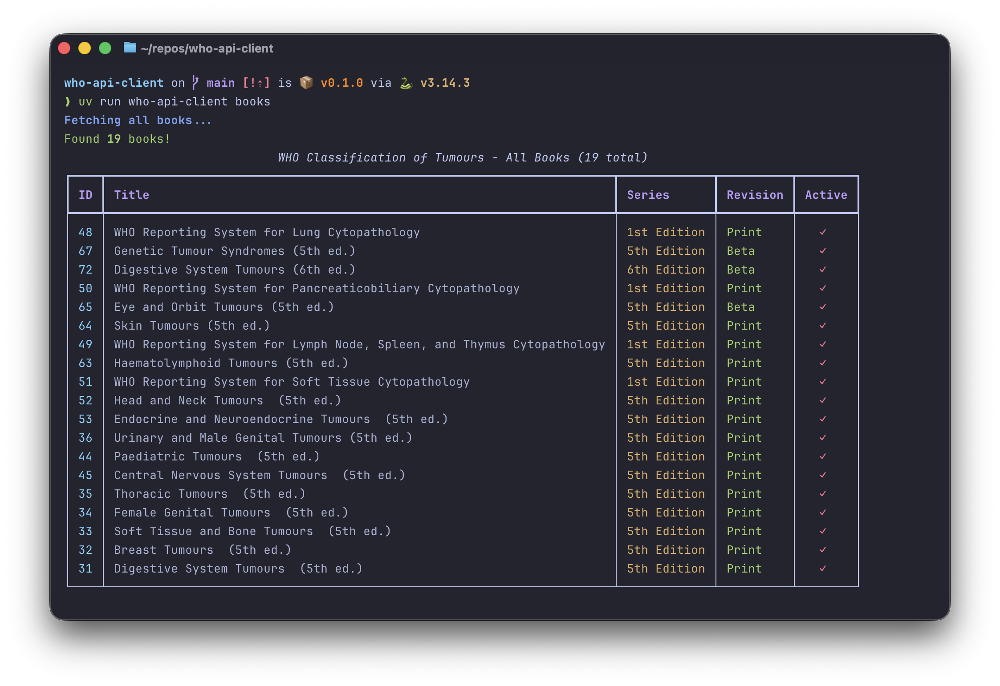

# WHO API Client

An **unofficial**, community-built Python client and CLI for the [WHO Classification of Tumours](https://tumourclassification.iarc.who.int/) web application. This project wraps the undocumented internal API used by the site's frontend — there is no official public API. Browse books, chapters, content, attachments, and search across the full WHO Classification database from the command line or from Python code.

> **Note:** This project is not affiliated with or endorsed by the World Health Organization or IARC. The API is undocumented and may change without notice. Users must comply with the [IARC/WHO Terms of Use](https://publications.iarc.who.int/Terms-Of-Use) at all times. A valid WHO Classification subscription is required.



## Features

- **Complete API coverage** - series, books, chapters, content, attachments, search, favourites, user profile
- **Type-safe Python API** - Pydantic v2 models with full validation for every endpoint
- **Rich CLI** - 15 commands with table, tree, JSON, and other output formats
- **Image downloads** - batch-download chapter figures with automatic WSI/table detection
- **Search** - simple text search from the CLI, advanced boolean search (AND/OR/NOT, parentheses) from Python
- **Secure credential storage** - system keyring, environment variables, or `.env` file
- **Automatic token management** - transparent login, refresh, and retry

## Requirements

- Python >= 3.10
- [uv](https://docs.astral.sh/uv/) package manager
- A [WHO Classification of Tumours](https://tumourclassification.iarc.who.int/) account with valid credentials

## Installation

```bash
git clone https://github.com/tbedau/who-api-client.git
cd who-api-client
uv sync
```

## Quick Start

```bash
# 1. Authenticate (interactive prompt)
uv run who-api-client login

# 2. Browse the catalogue
uv run who-api-client series
uv run who-api-client books
uv run who-api-client chapters 31

# 3. Read content
uv run who-api-client content 31 11
uv run who-api-client attachments 31 11

# 4. Search
uv run who-api-client search "adenocarcinoma"
```

## Authentication

The client checks for credentials in this order:

1. **Environment variables** (`WHO_EMAIL`, `WHO_PASSWORD`) - highest priority, ideal for CI/CD
2. **System keyring** - macOS Keychain, Windows Credential Manager, Linux Secret Service
3. **`.env` file** - development convenience

```bash
# Interactive login (saves to system keyring)
uv run who-api-client login

# Provide credentials directly
uv run who-api-client login --email you@example.com --password secret

# Save to .env file instead of keyring
uv run who-api-client login --save-to-env

# Check authentication status
uv run who-api-client status

# View your profile and subscription
uv run who-api-client profile

# Remove stored credentials
uv run who-api-client logout
```

## CLI Reference

### Authentication

| Command | Description |
|---------|-------------|
| `login` | Authenticate and save credentials |
| `logout` | Remove stored credentials |
| `status` | Check authentication status |
| `profile` | Show user profile and subscription details |

### Data Access

| Command | Arguments | Formats | Default |
|---------|-----------|---------|---------|
| `series` | | table, json | table |
| `books` | | table, json | table |
| `chapters` | `BOOK_ID` | tree, table, json | tree |
| `content` | `BOOK_ID CHAPTER_ID` | text, html, json | text |
| `attachments` | `BOOK_ID CHAPTER_ID` | list, json | list |
| `tables` | `BOOK_ID CHAPTER_ID` | markdown, json | markdown |
| `download-images` | `BOOK_ID CHAPTER_ID` | | |
| `ancestors` | `BOOK_ID CHAPTER_ID` | tree, table, json | tree |
| `favourites` | | tree, table, list, json | tree |
| `favorites` | | *(alias for favourites)* | |
| `search` | `QUERY` | table, list, json | table |

### Examples

```bash
# List all book series
uv run who-api-client series

# List books as JSON
uv run who-api-client books --format json

# Browse chapter tree, limit depth
uv run who-api-client chapters 31 --max-depth 2

# Read chapter content
uv run who-api-client content 31 11

# View raw HTML content
uv run who-api-client content 31 11 --format html

# List only figure attachments
uv run who-api-client attachments 31 11 --type figure

# Render tables as markdown
uv run who-api-client tables 31 11

# Download all figures from a chapter
uv run who-api-client download-images 31 11 --output ./images/

# Show chapter breadcrumb path
uv run who-api-client ancestors 31 11

# View favourites sorted by chapter
uv run who-api-client favourites --sort chapter

# Search specific books for a term
uv run who-api-client search "carcinoma" --books 31,32

# Search in headings and content
uv run who-api-client search "melanoma" --headings --content

# Search only headings (exclude chapters)
uv run who-api-client search "sarcoma" --no-chapters --headings
```

## Python API

```python
from who_api_client import WHOAPIClient

with WHOAPIClient() as client:
    # Browse the catalogue
    series = client.get_book_series()
    books = client.get_books()
    book = client.get_book(31)
    chapters = client.get_chapters(31)

    # Read content
    content = client.get_chapter_content(31, 11)
    for section in content:
        print(section.headingTitle)
        print(section.clean_content_text)

    # Attachments and images
    attachments = client.get_attachments(31, 11)
    figures = [a for a in attachments if a.is_figure]
    wsi = [a for a in attachments if a.is_wsi]
    tables = [a for a in attachments if a.is_table]

    # Download figures
    client.download_image(figures[0], "output.jpg")
    stats = client.download_chapter_images(31, 11, "./images/")

    # Chapter context
    ancestors = client.get_chapter_ancestors(31, 11)
    assignments = client.get_assignments(31, 11)

    # User info
    user = client.get_user_details()
    colors = client.get_book_colors(31)

    # Favourites
    favourites = client.get_favourites()
    client.add_chapter_to_favourites(31, 11)
    client.remove_chapter_from_favourites(31, 11)

    # Simple search
    results = client.search("adenocarcinoma", book_ids=[31, 32])

    # Advanced search with boolean logic
    results = client.advanced_search([
        ("sarcoma", None, True, False),       # (sarcoma
        ("lipoma", "OR", False, True),        # OR lipoma)
        ("tumour", "AND", False, False),      # AND tumour
    ], search_in="both")
```

### Client Methods

| Method | Returns | Description |
|--------|---------|-------------|
| `get_book_series()` | `BookSeriesResponse` | All series with their books |
| `get_books()` | `list[Book]` | All available books |
| `get_book(book_id)` | `Book` | Single book details |
| `get_chapters(book_id)` | `list[Chapter]` | Hierarchical chapter structure |
| `get_chapter_content(book_id, chapter_id)` | `list[ChapterContent]` | Chapter text content |
| `get_attachments(book_id, chapter_id)` | `list[Attachment]` | Images, tables, WSI |
| `get_chapter_ancestors(book_id, chapter_id)` | `list[ChapterAncestor]` | Breadcrumb path |
| `get_assignments(book_id, chapter_id)` | `list[Assignment]` | Contributors and roles |
| `get_book_colors(book_id)` | `BookColors` | Color theme configuration |
| `get_user_details()` | `UserDetails` | Profile and subscription |
| `get_favourites()` | `list[FavouriteBook]` | Favourite chapters by book |
| `add_chapter_to_favourites(book_id, chapter_id)` | `AddFavouriteResponse` | Add to favourites |
| `remove_chapter_from_favourites(book_id, chapter_id)` | `RemoveFavouriteResponse` | Remove from favourites |
| `is_chapter_in_favourites(book_id, chapter_id)` | `bool` | Check favourite status |
| `download_image(attachment, path)` | `None` | Download single figure |
| `download_chapter_images(book_id, chapter_id, dir)` | `dict` | Batch download figures |
| `search(text, ...)` | `SimpleSearchResponse` | Simple text search |
| `advanced_search(terms, ...)` | `AdvancedSearchResponse` | Boolean search |

## Data Model

```
BookSeries -> Book -> Chapter -> ChapterContent
                              -> Attachment (figure / WSI / table)
                              -> Assignment -> Contributor
                              -> ChapterAncestor (breadcrumb)
```

All text models provide `clean_*` properties that strip HTML tags, decode entities, and normalize whitespace.

`Attachment` objects expose type-detection properties: `is_figure`, `is_wsi`, `is_table`, `is_image`, and `image_type`.

## Security Considerations

This is an unofficial API client. Use it at your own risk.

**Credential storage:** The three credential backends have different security properties:

| Backend | Security | Notes |
|---------|----------|-------|
| System keyring | Best | OS-level encryption (macOS Keychain, Windows Credential Manager). Default and recommended. |
| Environment variables | Moderate | Suitable for CI/CD. May be visible in process listings or shell history. |
| `.env` file | Weakest | **Stores your password in plaintext on disk.** Use only if keyring is unavailable. Avoid committing this file — `.env` is in `.gitignore` by default. |

## Error Handling

| Exception | When |
|-----------|------|
| `ConfigurationError` | Missing or invalid credentials |
| `AuthenticationError` | Login failure or expired token |
| `TokenError` | Token operation failure |
| `WHOAPIError` | Base class for all client errors |

The client automatically retries on transient failures with exponential backoff, and re-authenticates when tokens expire.

## Development

```bash
# Install with dev dependencies
uv sync

# Run unit tests
uv run pytest tests/unit/

# Run with coverage
uv run pytest --cov=who_api_client

# Lint and format
uv run ruff check
uv run ruff format

# Run integration tests (requires valid credentials)
uv run pytest tests/integration/
```

## Disclaimer

This is an unofficial client that wraps the undocumented internal API of the WHO Classification of Tumours web application. It is not affiliated with, endorsed by, or in any way officially connected to the World Health Organization (WHO) or the International Agency for Research on Cancer (IARC).

- The API is **not public** — it is an undocumented internal API and may change or break at any time.
- A valid **WHO Classification subscription** is required to use this client.
- All content accessed through this client is subject to the [IARC/WHO Terms of Use](https://publications.iarc.who.int/Terms-Of-Use).
- Built-in rate limiting (0.5s between requests) helps avoid excessive load on WHO servers. Please do not disable or circumvent it.

## License

MIT
